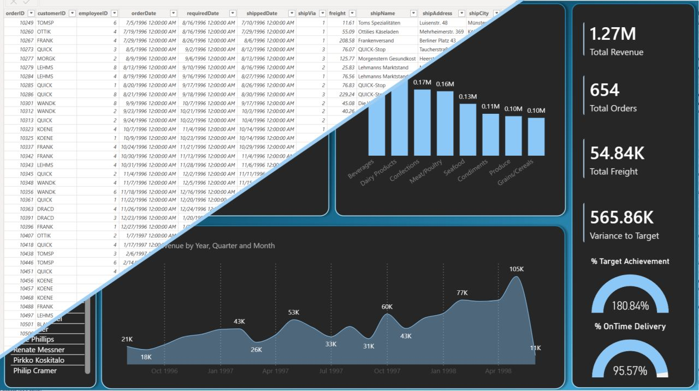
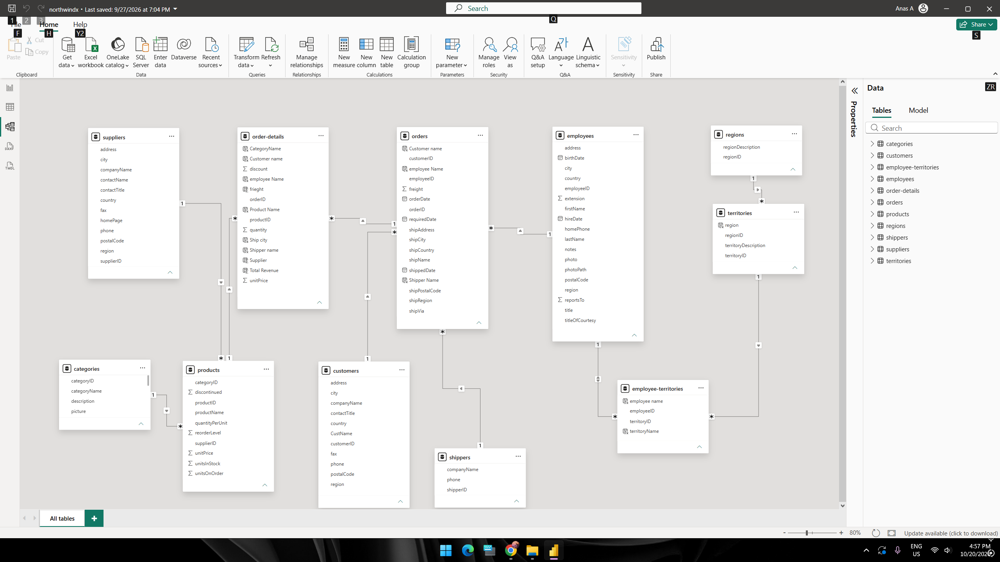

# Northwind Database: Data Modeling & Business Intelligence

---

## Overview

This project focuses on relational data modeling and Business Intelligence (BI) dashboard design using Microsoft's sample **Northwind** database.

> **Note:** This project is for educational and training purposes, focusing primarily on data architecture, Star Schema modeling, and DAX metric development in Power BI.

---

## Key Metrics & Extracted DAX KPIs

Based on the interactive dashboard calculations, key performance indicators include:

* **Total Revenue:** $1.27M
* **Total Orders:** 654
* **Total Freight:** 54.84K
* **Variance to Target:** 565.86K
* **Target Achievement Rate:** 180.84%
* **On-Time Delivery Rate:** 95.57%
* **Top Category by Revenue:** Beverages ($0.27M) followed by Dairy Products ($0.23M)

---

## Data Modeling & Architecture

Building a clean, scalable Data Model directly in Power BI ensures optimal relationship management and prevents query errors during data export:

* **Relational Schema:** Constructed a Star / Snowflake Schema establishing 1-to-Many relationships between Fact tables (`orders`, `order-details`) and Dimension tables (`customers`, `employees`, `products`, `categories`, `suppliers`, `shippers`, `regions`, `territories`).
* **Relational Integrity:** Managed foreign key mappings directly within Power BI Model View to maintain high query efficiency.

---

## Business Intelligence Dashboard

The developed Power BI interface tracks executive revenue streams, sales performance by employee, product category distributions, and delivery efficiency over time:

1. **Revenue Breakdown:** Monitors Total Revenue trends across quarters and years (peaking at $105K in April 1998).
2. **Employee Performance:** Ranks top sales performers by generated revenue.
3. **Category Insights:** Visualizes revenue distribution across product lines (`Beverages`, `Dairy Products`, `Confections`, `Meat/Poultry`).
4. **Logistics & Targets:** Evaluates target achievement percentage alongside on-time shipping rates.

---

## Practical Lessons & Best Practices

* **Power BI vs. Excel Modeling:** Building relationships and writing DAX measures directly in Power BI is faster, more flexible, and avoids data export errors that occur when modeling in Excel first.
* **Cleaning vs. Modeling:** Use Excel for basic data cleaning and initial exploration, but rely on Power BI for modeling and DAX implementation.
* **BI vs. Analytics:** Dashboard design constitutes Business Intelligence (BI); true diagnostic analytics begins after the dashboard is fully deployed.

---

## Tools Used

* **Power BI Desktop:** Power Query, Data Modeling, DAX
* **Microsoft Power Pivot & Star Schema Architecture**
